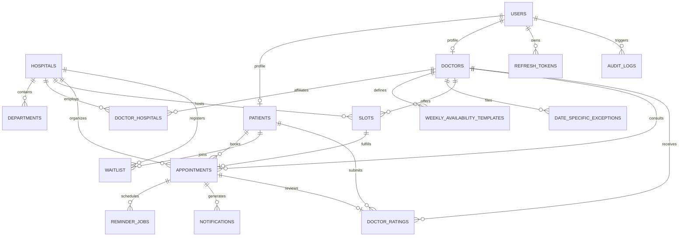

# MediSlot: Database Schema Specification
**Platform:** AI-Powered Multi-Hospital Healthcare Appointment Scheduling System  
**Engine:** PostgreSQL 16 (with SQLAlchemy 2.0 ORM)  
**Timezone Standard:** Storage in UTC (`TIMESTAMPTZ`); Display in `Asia/Kolkata` (IST, UTC+05:30)  
**File Location:** `D:\medislot\docs\DATABASE_SCHEMA.md`

---

## 1. Entity-Relationship Overview



---

## 2. Relational Table Specifications

### 2.1 Core Identity and Access

#### `users`
Stores system-wide user credentials, authentication metadata, and role assignments.
```sql
CREATE TABLE users (
    id UUID PRIMARY KEY DEFAULT gen_random_uuid(),
    email VARCHAR(255) NOT NULL UNIQUE,
    password_hash VARCHAR(255) NOT NULL,
    full_name VARCHAR(150) NOT NULL,
    phone VARCHAR(20) NOT NULL UNIQUE,
    role VARCHAR(30) NOT NULL, -- 'patient', 'doctor', 'hospital_admin', 'super_admin'
    hospital_id UUID REFERENCES hospitals(id) ON DELETE SET NULL, -- Scoped for hospital_admin
    is_active BOOLEAN NOT NULL DEFAULT TRUE,
    is_verified BOOLEAN NOT NULL DEFAULT FALSE,
    created_at TIMESTAMPTZ NOT NULL DEFAULT (NOW() AT TIME ZONE 'UTC'),
    updated_at TIMESTAMPTZ NOT NULL DEFAULT (NOW() AT TIME ZONE 'UTC'),
    CONSTRAINT check_user_role CHECK (role IN ('patient', 'doctor', 'hospital_admin', 'super_admin'))
);
CREATE INDEX idx_users_email ON users(email);
CREATE INDEX idx_users_role_hospital ON users(role, hospital_id);
```

#### `refresh_tokens`
Tracks rotating JWT refresh tokens with revocation support.
```sql
CREATE TABLE refresh_tokens (
    id UUID PRIMARY KEY DEFAULT gen_random_uuid(),
    user_id UUID NOT NULL REFERENCES users(id) ON DELETE CASCADE,
    token_hash VARCHAR(255) NOT NULL UNIQUE,
    expires_at TIMESTAMPTZ NOT NULL,
    revoked BOOLEAN NOT NULL DEFAULT FALSE,
    created_at TIMESTAMPTZ NOT NULL DEFAULT (NOW() AT TIME ZONE 'UTC')
);
CREATE INDEX idx_refresh_tokens_user ON refresh_tokens(user_id);
```

---

### 2.2 Healthcare Hierarchy

#### `hospitals`
Root organizational entity.
```sql
CREATE TABLE hospitals (
    id UUID PRIMARY KEY DEFAULT gen_random_uuid(),
    name VARCHAR(200) NOT NULL,
    slug VARCHAR(200) NOT NULL UNIQUE,
    address TEXT NOT NULL,
    city VARCHAR(100) NOT NULL,
    state VARCHAR(100) NOT NULL DEFAULT 'Tamil Nadu',
    postal_code VARCHAR(20) NOT NULL,
    phone VARCHAR(20) NOT NULL,
    email VARCHAR(255) NOT NULL,
    latitude DOUBLE PRECISION,
    longitude DOUBLE PRECISION,
    is_active BOOLEAN NOT NULL DEFAULT TRUE,
    created_at TIMESTAMPTZ NOT NULL DEFAULT (NOW() AT TIME ZONE 'UTC'),
    updated_at TIMESTAMPTZ NOT NULL DEFAULT (NOW() AT TIME ZONE 'UTC')
);
CREATE INDEX idx_hospitals_city ON hospitals(city);
```

#### `departments`
Clinical departments within each hospital.
```sql
CREATE TABLE departments (
    id UUID PRIMARY KEY DEFAULT gen_random_uuid(),
    hospital_id UUID NOT NULL REFERENCES hospitals(id) ON DELETE CASCADE,
    name VARCHAR(100) NOT NULL,
    description TEXT,
    is_active BOOLEAN NOT NULL DEFAULT TRUE,
    created_at TIMESTAMPTZ NOT NULL DEFAULT (NOW() AT TIME ZONE 'UTC'),
    updated_at TIMESTAMPTZ NOT NULL DEFAULT (NOW() AT TIME ZONE 'UTC'),
    CONSTRAINT uq_hospital_department UNIQUE (hospital_id, name)
);
CREATE INDEX idx_departments_hospital ON departments(hospital_id);
```

#### `patients`
Patient profiles with demographic and preference metadata.
```sql
CREATE TABLE patients (
    id UUID PRIMARY KEY DEFAULT gen_random_uuid(),
    user_id UUID NOT NULL UNIQUE REFERENCES users(id) ON DELETE CASCADE,
    date_of_birth DATE NOT NULL,
    gender VARCHAR(20) NOT NULL, -- 'male', 'female', 'other', 'prefer_not_to_say'
    blood_group VARCHAR(10),
    emergency_contact_name VARCHAR(150),
    emergency_contact_phone VARCHAR(20),
    preferred_language VARCHAR(50) NOT NULL DEFAULT 'English',
    created_at TIMESTAMPTZ NOT NULL DEFAULT (NOW() AT TIME ZONE 'UTC'),
    updated_at TIMESTAMPTZ NOT NULL DEFAULT (NOW() AT TIME ZONE 'UTC')
);
CREATE INDEX idx_patients_user ON patients(user_id);
```

#### `doctors`
Professional doctor profiles with specialties, languages, ratings, and experience.
```sql
CREATE TABLE doctors (
    id UUID PRIMARY KEY DEFAULT gen_random_uuid(),
    user_id UUID NOT NULL UNIQUE REFERENCES users(id) ON DELETE CASCADE,
    license_number VARCHAR(100) NOT NULL UNIQUE,
    specialty VARCHAR(100) NOT NULL,
    experience_years INTEGER NOT NULL DEFAULT 0,
    qualification VARCHAR(200) NOT NULL,
    bio TEXT,
    languages_spoken JSONB NOT NULL DEFAULT '["English"]'::jsonb,
    gender VARCHAR(20) NOT NULL,
    default_consultation_fee NUMERIC(10, 2) NOT NULL DEFAULT 500.00,
    is_verified BOOLEAN NOT NULL DEFAULT FALSE,
    rating_avg NUMERIC(3, 2) NOT NULL DEFAULT 4.00, -- Neutral prior for cold-start
    rating_count INTEGER NOT NULL DEFAULT 0,
    created_at TIMESTAMPTZ NOT NULL DEFAULT (NOW() AT TIME ZONE 'UTC'),
    updated_at TIMESTAMPTZ NOT NULL DEFAULT (NOW() AT TIME ZONE 'UTC')
);
CREATE INDEX idx_doctors_specialty ON doctors(specialty);
CREATE INDEX idx_doctors_rating ON doctors(rating_avg DESC);
```

#### `doctor_hospitals`
Many-to-many junction enabling doctors to practice across multiple hospitals with distinct rooms and fee schedules.
```sql
CREATE TABLE doctor_hospitals (
    id UUID PRIMARY KEY DEFAULT gen_random_uuid(),
    doctor_id UUID NOT NULL REFERENCES doctors(id) ON DELETE CASCADE,
    hospital_id UUID NOT NULL REFERENCES hospitals(id) ON DELETE CASCADE,
    department_id UUID REFERENCES departments(id) ON DELETE SET NULL,
    consultation_fee NUMERIC(10, 2) NOT NULL,
    room_number VARCHAR(50),
    is_primary BOOLEAN NOT NULL DEFAULT FALSE,
    is_active BOOLEAN NOT NULL DEFAULT TRUE,
    created_at TIMESTAMPTZ NOT NULL DEFAULT (NOW() AT TIME ZONE 'UTC'),
    updated_at TIMESTAMPTZ NOT NULL DEFAULT (NOW() AT TIME ZONE 'UTC'),
    CONSTRAINT uq_doctor_hospital UNIQUE (doctor_id, hospital_id)
);
CREATE INDEX idx_doctor_hospitals_hospital ON doctor_hospitals(hospital_id);
CREATE INDEX idx_doctor_hospitals_doctor ON doctor_hospitals(doctor_id);
```

---

### 2.3 Scheduling, Availability & Concurrency Guard

#### `weekly_availability_templates`
Recurring weekly clinical schedules per doctor per hospital.
```sql
CREATE TABLE weekly_availability_templates (
    id UUID PRIMARY KEY DEFAULT gen_random_uuid(),
    doctor_id UUID NOT NULL REFERENCES doctors(id) ON DELETE CASCADE,
    hospital_id UUID NOT NULL REFERENCES hospitals(id) ON DELETE CASCADE,
    day_of_week INTEGER NOT NULL, -- 0 = Monday, 6 = Sunday
    start_time TIME NOT NULL,
    end_time TIME NOT NULL,
    slot_duration_minutes INTEGER NOT NULL DEFAULT 20,
    is_active BOOLEAN NOT NULL DEFAULT TRUE,
    created_at TIMESTAMPTZ NOT NULL DEFAULT (NOW() AT TIME ZONE 'UTC'),
    updated_at TIMESTAMPTZ NOT NULL DEFAULT (NOW() AT TIME ZONE 'UTC'),
    CONSTRAINT check_day_of_week CHECK (day_of_week BETWEEN 0 AND 6),
    CONSTRAINT check_time_order CHECK (end_time > start_time)
);
CREATE INDEX idx_templates_doctor_day ON weekly_availability_templates(doctor_id, day_of_week);
```

#### `date_specific_exceptions`
Overrides for leaves, public holidays, or blocked shifts.
```sql
CREATE TABLE date_specific_exceptions (
    id UUID PRIMARY KEY DEFAULT gen_random_uuid(),
    doctor_id UUID NOT NULL REFERENCES doctors(id) ON DELETE CASCADE,
    hospital_id UUID REFERENCES hospitals(id) ON DELETE CASCADE,
    exception_date DATE NOT NULL,
    start_time TIME, -- NULL means entire day blocked
    end_time TIME,
    exception_type VARCHAR(30) NOT NULL, -- 'leave', 'holiday', 'blocked', 'custom_hours'
    reason VARCHAR(255),
    is_active BOOLEAN NOT NULL DEFAULT TRUE,
    created_at TIMESTAMPTZ NOT NULL DEFAULT (NOW() AT TIME ZONE 'UTC'),
    CONSTRAINT check_exception_type CHECK (exception_type IN ('leave', 'holiday', 'blocked', 'custom_hours'))
);
CREATE INDEX idx_exceptions_doctor_date ON date_specific_exceptions(doctor_id, exception_date);
```

#### `slots`
Discrete bookable clinical time intervals.
```sql
CREATE TABLE slots (
    id UUID PRIMARY KEY DEFAULT gen_random_uuid(),
    doctor_id UUID NOT NULL REFERENCES doctors(id) ON DELETE CASCADE,
    hospital_id UUID NOT NULL REFERENCES hospitals(id) ON DELETE CASCADE,
    slot_start TIMESTAMPTZ NOT NULL,
    slot_end TIMESTAMPTZ NOT NULL,
    status VARCHAR(20) NOT NULL DEFAULT 'available', -- 'available', 'booked', 'blocked'
    is_locked BOOLEAN NOT NULL DEFAULT FALSE,
    locked_until TIMESTAMPTZ,
    created_at TIMESTAMPTZ NOT NULL DEFAULT (NOW() AT TIME ZONE 'UTC'),
    updated_at TIMESTAMPTZ NOT NULL DEFAULT (NOW() AT TIME ZONE 'UTC'),
    
    -- CRITICAL CONSTRAINTS:
    CONSTRAINT uq_doctor_slot_start UNIQUE (doctor_id, slot_start),
    CONSTRAINT check_slot_status CHECK (status IN ('available', 'booked', 'blocked')),
    CONSTRAINT check_slot_interval CHECK (slot_end > slot_start)
);
CREATE INDEX idx_slots_search ON slots(doctor_id, hospital_id, slot_start) WHERE status = 'available';
CREATE INDEX idx_slots_hospital_start ON slots(hospital_id, slot_start);
```

---

### 2.4 Appointments and State Machine

#### `appointments`
Represents booked consultations with complete lifecycle tracking and queue timings.
```sql
CREATE TABLE appointments (
    id UUID PRIMARY KEY DEFAULT gen_random_uuid(),
    appointment_number VARCHAR(30) NOT NULL UNIQUE, -- E.g. MED-20261014-9X8K
    slot_id UUID NOT NULL UNIQUE REFERENCES slots(id) ON DELETE RESTRICT,
    doctor_id UUID NOT NULL REFERENCES doctors(id) ON DELETE RESTRICT,
    hospital_id UUID NOT NULL REFERENCES hospitals(id) ON DELETE RESTRICT,
    patient_id UUID NOT NULL REFERENCES patients(id) ON DELETE RESTRICT,
    
    appointment_type VARCHAR(20) NOT NULL DEFAULT 'new_patient', -- 'new_patient', 'follow_up'
    status VARCHAR(30) NOT NULL DEFAULT 'booked',
    
    -- Queue & Timing Metrics (all in UTC)
    check_in_time TIMESTAMPTZ,
    consultation_start_time TIMESTAMPTZ,
    consultation_end_time TIMESTAMPTZ,
    actual_duration_minutes INTEGER,
    estimated_duration_minutes INTEGER NOT NULL DEFAULT 20,
    estimated_wait_minutes INTEGER,
    queue_number INTEGER,
    
    -- Telemedicine & Cancellation
    telemedicine_meeting_url VARCHAR(500),
    cancellation_reason TEXT,
    cancelled_by_user_id UUID REFERENCES users(id),
    notes TEXT,
    
    created_at TIMESTAMPTZ NOT NULL DEFAULT (NOW() AT TIME ZONE 'UTC'),
    updated_at TIMESTAMPTZ NOT NULL DEFAULT (NOW() AT TIME ZONE 'UTC'),
    
    CONSTRAINT check_appointment_status CHECK (
        status IN ('booked', 'checked_in', 'in_consultation', 'completed', 'cancelled', 'no_show')
    ),
    CONSTRAINT check_appointment_type CHECK (
        appointment_type IN ('new_patient', 'follow_up')
    )
);
CREATE INDEX idx_appointments_patient ON appointments(patient_id, created_at DESC);
CREATE INDEX idx_appointments_doctor_status ON appointments(doctor_id, status);
CREATE INDEX idx_appointments_hospital_status ON appointments(hospital_id, status);
CREATE INDEX idx_appointments_daily_queue ON appointments(doctor_id, hospital_id, status) 
    WHERE status IN ('booked', 'checked_in', 'in_consultation');
```

---

### 2.5 Waitlist, Reminders and Notifications

#### `waitlist`
Patients queuing for cancellations on fully booked dates.
```sql
CREATE TABLE waitlist (
    id UUID PRIMARY KEY DEFAULT gen_random_uuid(),
    patient_id UUID NOT NULL REFERENCES patients(id) ON DELETE CASCADE,
    doctor_id UUID NOT NULL REFERENCES doctors(id) ON DELETE CASCADE,
    hospital_id UUID NOT NULL REFERENCES hospitals(id) ON DELETE CASCADE,
    preferred_date DATE NOT NULL,
    preferred_time_range VARCHAR(20) NOT NULL DEFAULT 'any', -- 'morning', 'afternoon', 'evening', 'any'
    status VARCHAR(20) NOT NULL DEFAULT 'waiting', -- 'waiting', 'offered', 'accepted', 'expired', 'cancelled'
    offered_slot_id UUID REFERENCES slots(id) ON DELETE SET NULL,
    offer_expires_at TIMESTAMPTZ,
    created_at TIMESTAMPTZ NOT NULL DEFAULT (NOW() AT TIME ZONE 'UTC'),
    updated_at TIMESTAMPTZ NOT NULL DEFAULT (NOW() AT TIME ZONE 'UTC'),
    CONSTRAINT check_waitlist_status CHECK (status IN ('waiting', 'offered', 'accepted', 'expired', 'cancelled'))
);
CREATE INDEX idx_waitlist_queue ON waitlist(doctor_id, preferred_date, status);
```

#### `reminder_jobs`
Idempotent scheduled reminders and one-click token verification.
```sql
CREATE TABLE reminder_jobs (
    id UUID PRIMARY KEY DEFAULT gen_random_uuid(),
    appointment_id UUID NOT NULL REFERENCES appointments(id) ON DELETE CASCADE,
    reminder_type VARCHAR(30) NOT NULL, -- 'booking_confirmation', 'reminder_24h', 'reminder_2h', 'high_risk_extra'
    scheduled_for TIMESTAMPTZ NOT NULL,
    status VARCHAR(20) NOT NULL DEFAULT 'scheduled', -- 'scheduled', 'processing', 'completed', 'failed', 'cancelled'
    confirmation_token VARCHAR(255) NOT NULL UNIQUE,
    token_expires_at TIMESTAMPTZ NOT NULL,
    is_responded BOOLEAN NOT NULL DEFAULT FALSE,
    response_action VARCHAR(20), -- 'confirmed', 'cancelled'
    execution_count INTEGER NOT NULL DEFAULT 0,
    last_executed_at TIMESTAMPTZ,
    created_at TIMESTAMPTZ NOT NULL DEFAULT (NOW() AT TIME ZONE 'UTC'),
    
    -- IDEMPOTENCY GUARANTEE:
    CONSTRAINT uq_reminder_job UNIQUE (appointment_id, reminder_type),
    CONSTRAINT check_reminder_status CHECK (status IN ('scheduled', 'processing', 'completed', 'failed', 'cancelled'))
);
CREATE INDEX idx_reminder_pending ON reminder_jobs(status, scheduled_for) WHERE status = 'scheduled';
```

#### `notifications`
Audit trail of sent communications (emails/SMS/in-app).
```sql
CREATE TABLE notifications (
    id UUID PRIMARY KEY DEFAULT gen_random_uuid(),
    user_id UUID NOT NULL REFERENCES users(id) ON DELETE CASCADE,
    appointment_id UUID REFERENCES appointments(id) ON DELETE SET NULL,
    notification_type VARCHAR(50) NOT NULL,
    channel VARCHAR(20) NOT NULL DEFAULT 'email', -- 'email', 'sms', 'in_app'
    recipient VARCHAR(255) NOT NULL,
    title VARCHAR(255) NOT NULL,
    body TEXT NOT NULL,
    status VARCHAR(20) NOT NULL DEFAULT 'pending', -- 'pending', 'sent', 'failed'
    sent_at TIMESTAMPTZ,
    error_message TEXT,
    created_at TIMESTAMPTZ NOT NULL DEFAULT (NOW() AT TIME ZONE 'UTC')
);
CREATE INDEX idx_notifications_user ON notifications(user_id, created_at DESC);
```

---

### 2.6 Feedback, Auditing & AI Logs

#### `doctor_ratings`
Patient reviews moderated by hospital administrators.
```sql
CREATE TABLE doctor_ratings (
    id UUID PRIMARY KEY DEFAULT gen_random_uuid(),
    appointment_id UUID NOT NULL UNIQUE REFERENCES appointments(id) ON DELETE CASCADE,
    doctor_id UUID NOT NULL REFERENCES doctors(id) ON DELETE CASCADE,
    patient_id UUID NOT NULL REFERENCES patients(id) ON DELETE CASCADE,
    rating INTEGER NOT NULL,
    review_text TEXT,
    is_moderated BOOLEAN NOT NULL DEFAULT FALSE,
    moderation_status VARCHAR(20) NOT NULL DEFAULT 'pending', -- 'pending', 'approved', 'rejected'
    moderated_by UUID REFERENCES users(id) ON DELETE SET NULL,
    moderated_at TIMESTAMPTZ,
    created_at TIMESTAMPTZ NOT NULL DEFAULT (NOW() AT TIME ZONE 'UTC'),
    updated_at TIMESTAMPTZ NOT NULL DEFAULT (NOW() AT TIME ZONE 'UTC'),
    CONSTRAINT check_rating_range CHECK (rating BETWEEN 1 AND 5),
    CONSTRAINT check_moderation_status CHECK (moderation_status IN ('pending', 'approved', 'rejected'))
);
CREATE INDEX idx_ratings_doctor ON doctor_ratings(doctor_id) WHERE moderation_status = 'approved';
```

#### `audit_logs`
Mandatory compliance audit trail logging access and mutations on appointment and patient records.
```sql
CREATE TABLE audit_logs (
    id UUID PRIMARY KEY DEFAULT gen_random_uuid(),
    user_id UUID REFERENCES users(id) ON DELETE SET NULL,
    action VARCHAR(50) NOT NULL, -- E.g. 'VIEW_APPOINTMENT', 'CREATE_APPOINTMENT', 'UPDATE_STATUS'
    resource_type VARCHAR(50) NOT NULL, -- 'appointment', 'patient', 'doctor', 'hospital'
    resource_id VARCHAR(100) NOT NULL,
    hospital_id UUID REFERENCES hospitals(id) ON DELETE SET NULL,
    ip_address VARCHAR(45),
    user_agent VARCHAR(255),
    details JSONB,
    created_at TIMESTAMPTZ NOT NULL DEFAULT (NOW() AT TIME ZONE 'UTC')
);
CREATE INDEX idx_audit_hospital_created ON audit_logs(hospital_id, created_at DESC);
CREATE INDEX idx_audit_user_created ON audit_logs(user_id, created_at DESC);
```

#### `ai_interaction_logs`
Anonymized telemetry for Gemini AI interactions ensuring patient data privacy.
```sql
CREATE TABLE ai_interaction_logs (
    id UUID PRIMARY KEY DEFAULT gen_random_uuid(),
    user_id UUID REFERENCES users(id) ON DELETE SET NULL,
    session_id VARCHAR(100),
    feature_type VARCHAR(50) NOT NULL, -- 'symptom_triage', 'nl_search', 'booking_assistant'
    input_text_anonymized TEXT NOT NULL,
    red_flag_triggered BOOLEAN NOT NULL DEFAULT FALSE,
    urgency_level VARCHAR(30), -- 'routine', 'soon', 'emergency'
    extracted_entities JSONB,
    tools_called JSONB,
    raw_response_json JSONB,
    latency_ms INTEGER NOT NULL,
    status VARCHAR(30) NOT NULL DEFAULT 'success', -- 'success', 'fallback', 'quota_exceeded', 'error'
    created_at TIMESTAMPTZ NOT NULL DEFAULT (NOW() AT TIME ZONE 'UTC')
);
CREATE INDEX idx_ai_logs_feature ON ai_interaction_logs(feature_type, created_at DESC);
```

---

## 3. Concurrency & Double-Booking Prevention

### 3.1 Two-Layer Defense Strategy

1. **Database Layer (Hard Invariant):**
   ```sql
   CONSTRAINT uq_doctor_slot_start UNIQUE (doctor_id, slot_start)
   ```
   Ensures that at the storage level, no two slots can exist for the same doctor at the same UTC timestamp across any hospital.

2. **Transaction Layer (Row Locking):**
   ```python
   # SQLAlchemy transactional execution
   async with session.begin():
       stmt = (
           select(Slot)
           .where(Slot.id == slot_id, Slot.status == "available")
           .with_for_update()  # Issues SELECT ... FOR UPDATE
       )
       slot = (await session.execute(stmt)).scalar_one_or_none()
       if not slot:
           raise HTTPException(status_code=409, detail="Slot is no longer available")
       
       slot.status = "booked"
       appointment = Appointment(
           slot_id=slot.id,
           doctor_id=slot.doctor_id,
           hospital_id=slot.hospital_id,
           patient_id=current_patient.id,
           status="booked",
           ...
       )
       session.add(appointment)
   ```
