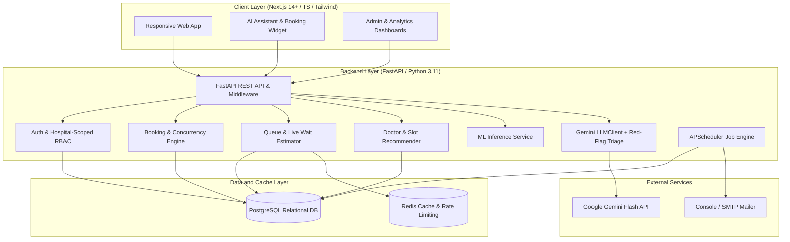

# MediSlot: Master Implementation Plan
**Tagline:** *"Right doctor. Right slot. Less waiting."*  
**Platform:** AI-Powered Multi-Hospital Healthcare Appointment Scheduling System  
**Project Location:** `D:\medislot`  
**Phase:** Phase 0 (Implementation Plan & Database Schema)

---

## 1. Executive Summary & Architecture Overview

MediSlot is an enterprise-grade, multi-hospital appointment scheduling and clinical queue management platform. It addresses three primary bottlenecks in modern outpatient care:
1. **Inefficient Matching:** Patients frequently book inappropriate specialties or suboptimal locations.
2. **Scheduling Friction & High No-Show Rates:** Outpatient no-show rates range from 15% to 30%, resulting in wasted clinical capacity.
3. **Unpredictable Waiting Times:** Discrepancies between booked slot times and actual consultation times erode patient trust and overload waiting areas.

### 1.1 High-Level Architecture



### 1.2 Technology Stack

| Layer | Technology | Rationale & Specifications |
| :--- | :--- | :--- |
| **Frontend** | Next.js (App Router), TypeScript, Tailwind CSS, Lucide Icons, Recharts | Premium, accessible UI with dark/light themes, server-side rendering, and responsive dashboards |
| **Backend** | Python 3.11, FastAPI, Pydantic v2, SQLAlchemy 2.0, Alembic | High-performance asynchronous API, robust schema validation, type safety, enterprise ORM |
| **Database** | PostgreSQL 16 (Primary) + Redis 7 (Cache/Queue) | ACID compliance, transactional `SELECT FOR UPDATE` row-locking, relational integrity |
| **Authentication** | JWT (Short-lived access: 15m, Refresh: 7d), Argon2id password hashing | OWASP-compliant secure auth, role-based access control with hospital tenancy isolation |
| **Background Jobs** | APScheduler 3.x / Redis | Automated reminders (24h, 2h before), waitlist slot offers, automated no-show status triggers |
| **Machine Learning**| scikit-learn, pandas, numpy, joblib | Logistic Regression & Gradient Boosting for no-show risk; Linear/Ridge regression for waiting time |
| **LLM / AI** | Google Gemini API (`google-genai` SDK) | Flash-class models via `GEMINI_MODEL`, red-flag triage pre-filter, structured Pydantic schema outputs, token rate limiting |
| **Tests** | Pytest, HTTPX, Playwright e2e | Unit tests, concurrency tests, RBAC hospital scoping tests, e2e booking tests |
| **Deployment** | Docker & Docker Compose | Multi-container setup (app, db, redis) ready for local dev, Render, Railway, Vercel |

---

## 2. Core Security & Tenancy Model

### 2.1 Hospital-Scoped Role-Based Access Control (RBAC)

MediSlot enforces strict multi-tenancy at the query layer:

| Role | Permissions & Scope |
| :--- | :--- |
| **`patient`** | Register, view/edit own profile, search doctors across all hospitals, book/reschedule/cancel own appointments, view own queue estimates, AI chat. |
| **`doctor`** | View own profile & schedules, update weekly templates & date-specific leaves, view daily appointments for their assigned hospitals, update live consultation status (`checked_in`, `in_consultation`, `completed`, `no_show`). Cannot access other doctors' data. |
| **`hospital_admin`** | Manage departments, doctors, schedules, slot configurations, and view analytics **strictly restricted to their assigned `hospital_id`**. Query filters strictly enforce `WHERE hospital_id = current_user.hospital_id`. |
| **`super_admin`** | Create hospitals, verify doctor profiles across the platform, manage system users, configure global weights/parameters, view cross-hospital analytics. |

### 2.2 Single-Hospital Mode vs. Multi-Hospital Mode

The platform supports both multi-hospital network deployment and single-hospital deployment via `SINGLE_HOSPITAL_MODE=true` environment configuration or when only one hospital exists in the database. When active:
- The hospital selector dropdown is hidden from the patient search and booking interface.
- Queries automatically bind to the single default hospital.
- All multi-hospital backend constraints remain intact, ensuring zero code branching or schema divergence.

---

## 3. Detailed Phase Breakdown

### Phase 0: Architecture, Implementation Plan & Database Schema (Current)
- **Objective:** Finalize system design, define comprehensive data schema, establish repository layout, create `/docs/PROGRESS.md` and obtain user approval.
- **Deliverables:**
  - `docs/IMPLEMENTATION_PLAN.md` (this file)
  - `docs/DATABASE_SCHEMA.md` (complete PostgreSQL DDL & SQLAlchemy models)
  - `docs/PROGRESS.md` (initial status tracker)
  - Core directory structure in `D:\medislot`

---

### Phase 1: Auth, Hospital-Scoped RBAC, Doctors & Seed Data
- **Objective:** Build the foundational security, multi-hospital organizational structure, user management, and deterministic seed dataset.
- **Key Modules:**
  - `backend/app/core/security.py`: Argon2id password hashing, JWT creation & verification (access token 15 min, refresh token 7 days).
  - `backend/app/core/dependencies.py`: Current user extraction, role enforcement, hospital tenancy enforcement.
  - `backend/app/models/`: SQLAlchemy 2.0 models for `User`, `Hospital`, `Department`, `Doctor`, `DoctorHospital`.
  - `backend/app/api/v1/auth.py`: `/auth/register`, `/auth/login`, `/auth/refresh`, `/auth/me`.
  - `backend/app/api/v1/hospitals.py` & `doctors.py`: CRUD for hospitals, departments, doctor profiles.
  - `scripts/seed_data.py`: Deterministic seed script creating:
    - 4 fictional hospitals in Western Tamil Nadu (Coimbatore, Erode, Tiruppur, Dharapuram).
    - 10 medical specialties.
    - 40 fictional doctors with realistic qualifications, languages (English, Tamil, Hindi), consultation fees.
    - 500 fictional patients with demographic data.
    - Super admin, hospital admins, doctor accounts.
- **Testing:**
  - Pytest for authentication, token refresh, password hashing.
  - Pytest for RBAC & hospital tenancy isolation: verify that `hospital_admin` of Hospital A cannot access or modify Hospital B records (expect HTTP 403 Forbidden).

---

### Phase 2: Availability, Booking Engine, Concurrency & Waitlist
- **Objective:** Implement slot generation, robust transaction booking with row locking to eliminate race conditions, appointment lifecycle state machine, and automated waitlist mechanics.
- **Key Modules:**
  - `backend/app/services/availability.py`: Recurring weekly templates + date-specific leaves/overrides. Slot generation engine with dynamic slot intervals (15m, 20m, 30m).
  - `backend/app/services/booking.py`:
    - Strict transaction with `SELECT ... FOR UPDATE` row locking.
    - Unique constraint `(doctor_id, slot_start)` enforcement.
    - State machine transitions:
      - Valid: `booked` -> `checked_in` -> `in_consultation` -> `completed`
      - Valid: `booked` -> `cancelled` / `no_show`
      - Valid: `checked_in` -> `cancelled` / `no_show`
      - Invalid: `completed` -> `cancelled` (rejected), `cancelled` -> `in_consultation` (rejected).
  - `backend/app/services/waitlist.py`: When a booking is cancelled:
    - Automatically locate patients on the waitlist for that doctor and date.
    - Generate a time-limited booking offer (e.g., 30-minute claim window) and notify the patient.
  - `backend/app/api/v1/appointments.py`: Booking, cancellation, reschedule endpoints with audit logging.
- **Testing:**
  - Concurrency test: 20 simultaneous threads attempting to book the exact same slot; verify exactly 1 succeeds (HTTP 201) and 19 fail gracefully (HTTP 409 Conflict).
  - State machine transition validation test suite.

---

### Phase 3: Automated Reminders & Notification System
- **Objective:** Reliable, idempotent job scheduling for appointment lifecycle notifications.
- **Key Modules:**
  - `backend/app/services/reminder.py`:
    - Booking confirmation notifications.
    - 24-hour advance reminder.
    - 2-hour advance reminder.
    - Doctor delay alerts (when live queue exceeds threshold).
    - Cancellation and reschedule notices.
  - One-click confirm/cancel signed tokens (HMAC-SHA256 with expiry) allowing patients to respond directly without entering credentials.
  - High-risk no-show intervention: integration with ML no-show model to schedule targeted extra confirmations for high-risk patients.
  - Idempotent execution: `reminder_jobs` ledger ensuring retries never trigger duplicate emails.
  - Mock/Console SMTP provider for local dev with real SMTP configuration support via environment variables.
- **Testing:**
  - Pytest for reminder idempotency: repeated execution of reminder worker produces exactly one sent record.
  - Pytest for signed token verification and expiration.

---

### Phase 4: Simulator, Queue Estimation, Slot & Doctor Recommendation
- **Objective:** Deterministic smart features for doctor recommendations, slot ranking, dynamic live queue tracking, and realistic synthetic appointment history simulator.
- **Key Modules:**
  - `scripts/simulate_history.py`:
    - Generates 6 months of historical appointments.
    - Log-normal consultation duration distribution (mean: 18m, sigma: 0.35).
    - Realistic delays, cancellations (~12%), no-shows (~18%).
    - Live demo simulation mode: doctor start/end consultation events.
  - `backend/app/services/recommendation.py`:
    - Hard filters: specialty, city, verified doctors.
    - Multi-factor score = w1*specialty + w2*distance + w3*earliest_slot + w4*rating + w5*experience + w6*language.
    - Configurable weights with cold-start fallback (neutral Bayesian prior of 4.0 for new doctors).
    - Human-readable explanation generator: *"Next slot tomorrow 10:30 AM, 2.4 km away, rated 4.8/5"*.
  - `backend/app/services/smart_slots.py`:
    - Free slot ranking highlighting the Top 3 "Suggested" slots.
    - Criteria: patient's historical preferred time of day, gap-filling adjacent to existing bookings, doctor load balancing, accumulated late-day delay penalty.
  - `backend/app/services/queue.py`:
    - Dynamic queue position & waiting time range (e.g., *"20–30 mins"*).
    - Baseline: patients_ahead * avg_duration.
    - Improved dynamic model: per-doctor per-appointment-type historical duration + live delay offset (T_live_delay = max(0, now - expected_slot_end)).
- **Testing:**
  - Pytest for ranking algorithm with deterministic test scenarios.
  - Pytest for queue estimation under varied live delay scenarios.

---

### Phase 5: Machine Learning Models & Evaluation Pipeline
- **Objective:** Train, validate, serialize, and serve production ML models for no-show risk prediction and waiting time estimation using historical outpatient dataset.
- **Key Modules:**
  - `ml/train_no_show.py`:
    - Features: `lead_time_days`, `past_no_shows`, `past_appointments`, `appointment_type` (new vs. follow-up), `day_of_week`, `hour_of_day`, `age_group`, `reminder_responded`.
    - Models: Logistic Regression (baseline) and Gradient Boosting / Random Forest.
    - Metrics: ROC-AUC, Precision, Recall, F1-Score compared against naive majority-class baseline.
  - `ml/train_wait_time.py`:
    - Linear & Ridge regression for consultation duration and delay accumulation.
    - Evaluation: Mean Absolute Error (MAE) compared to baseline rule.
  - Model serialization: saved via `joblib` into `backend/app/ml/models/`.
  - Inference service in FastAPI with caching.
  - Integration: Replace Phase 3 heuristic stub hook with trained ML model.
  - Evaluation script (`ml/evaluate.py`): Offline evaluation computing ROC-AUC, precision, recall, confusion matrix, wait-time MAE.
- **Testing:**
  - Pytest validating ML model loading, feature transformation, inference schema, and latency (< 20ms).

---

### Phase 5.5: Next.js + TypeScript + Tailwind Frontend Core
- **Objective:** Build responsive, high-performance web frontend application providing full patient booking and doctor queue management workflows.
- **Key Modules (`frontend/`):**
  - **Project Setup:** Next.js 14+ (App Router), TypeScript, Tailwind CSS, Lucide Icons, clean design system.
  - **Authentication:** Login and Register pages supporting patients and doctors, JWT token storage, protected routes.
  - **Search & Discovery:** Doctor search with medical specialty, hospital filter, location, language, and gender preferences.
  - **Doctor Profile & Smart Slot Picker:** Doctor credentials, affiliations, ratings, reviews, and interactive slot picker highlighting Top 3 "Suggested" slot badges with clinical rationales.
  - **Booking Flow:** Multi-step reservation (appointment type, symptoms, review, confirmation) with concurrency handling.
  - **My Appointments & Live Queue Tracker:** Patient dashboard displaying upcoming and past appointments, live day-of-appointment queue tracker (queue number, patients ahead, dynamic wait time range).
  - **Doctor Dashboard:** Doctor daily clinical queue, patient check-in, start/end consultation status controls, and delay alerts.
- **Testing:**
  - End-to-end integration verification between Next.js frontend and FastAPI backend.

---

### Phase 6: AI Features (Gemini API Integration & Guardrails)
- **Objective:** Develop the AI layer following strict safety principles: *the LLM interprets and explains; deterministic code decides and acts*.
- **Key Modules:**
  - `backend/app/services/llm_client.py`:
    - Clean abstraction using the official `google-genai` SDK.
    - Model dynamically loaded from `GEMINI_MODEL` (e.g., `gemini-2.5-flash`), key from `GEMINI_API_KEY`.
    - Pydantic schema validation for all structured JSON outputs.
    - Resilient network calls: timeout (8s), exponential backoff retry (3 attempts).
    - In-memory/Redis query caching.
    - Per-user rate limiting & daily token/call quota tracker to safeguard free-tier limits.
    - Graceful fallback: when AI is unreachable or quota is exceeded, seamlessly fallback to deterministic keyword search and manual specialty dropdown.
  - **Feature A: Symptom-to-Specialty Assistant**
    - **Step 1: Deterministic Red-Flag Emergency Triage.** First runs an internal rule-based keyword check (e.g., *chest pain with breathlessness, sudden numbness/stroke signs, severe bleeding, loss of consciousness, suicidal ideation*). If detected, LLM is bypassed immediately, and emergency instructions (Call 112 / 108) are presented with zero booking prompts.
    - **Step 2: LLM Specialty Mapping.** Constrained to return valid specialties from the system database. Includes urgency level (`routine`, `soon`, `emergency`), reasoning, and clarifying questions. Mandated disclaimer: *"This is not a diagnosis. It only suggests which type of doctor to consult."*
  - **Feature B: Natural-Language Doctor Search**
    - Extracts structured filters (`specialty`, `gender`, `city`, `date_range`, `language`) from natural language input (e.g. *"female dermatologist in Coimbatore this weekend, Tamil speaking"*), feeding directly into the deterministic search engine.
  - **Feature C: Conversational Booking Assistant**
    - Gemini function calling with strictly scoped tools: `search_doctors`, `get_slots`, `book_appointment`, `reschedule_appointment`, `cancel_appointment`, `get_my_appointments`.
    - Security constraint: Tools run with the patient's authenticated JWT session.
    - Human-in-the-loop: The AI can only *propose* a slot; the user must click an explicit confirmation button in the UI before any booking transaction is executed.
    - Full audit logging in `ai_interaction_logs`.
- **Testing:**
  - Pytest for red-flag detection (100% recall target on emergency symptoms).
  - Pytest for LLM JSON schema validation and graceful fallback on malformed API responses.

---

### Phase 7: Full Frontend Dashboards, E2E Testing & Final Evaluation
- **Objective:** Build polished Next.js pages, dark/light theme, admin dashboards with charts, automated Playwright e2e tests, evaluation report, and comprehensive documentation.
- **Key Modules:**
  - **Next.js Frontend Pages (`frontend/`):**
    - `/`: Modern landing page with hero, search, features, and quick book.
    - `/auth/login` & `/auth/register`: Role-based authentication flow.
    - `/search`: Multi-filter doctor search + NL search bar + suggested badges.
    - `/doctors/[id]`: Doctor profile, credentials, slot picker with "Suggested" indicators.
    - `/booking/[slot_id]`: Booking review, appointment type selection, instant confirmation.
    - `/my-appointments`: Patient portal with live day-of-appointment queue tracker.
    - `/doctor/dashboard`: Doctor portal: daily timeline, patient check-in, start/end consultation buttons, slot blocking.
    - `/admin/dashboard`: Hospital Admin dashboard: departmental statistics, doctor utilization, no-show rates.
    - `/super-admin/dashboard`: Super Admin portal: hospital management, doctor verification, platform-wide analytics.
    - `AIChatWidget`: Floating AI assistant with consent modal, emergency banner, and booking proposal cards.
  - **Testing & Quality Assurance:**
    - Playwright e2e test covering patient registration -> search -> slot selection -> booking -> verification in "My Appointments".
    - Full Pytest suite execution across all services.
  - **Evaluation & Documentation:**
    - `evaluation/EVALUATION_REPORT.md`: Comprehensive evaluation covering wait-time MAE, no-show AUC/precision/recall, recommendation sanity check, specialty top-1/top-3 accuracy, emergency recall, NL extraction accuracy, latency benchmarks.
    - `README.md`: Architecture diagrams, setup guide, environment variable reference, demo credentials, synthetic data disclaimer.
    - Final update to `/docs/PROGRESS.md`.

---

## 4. Verification and Testing Matrix

| Component | Test Type | Tools | Target Criteria |
| :--- | :--- | :--- | :--- |
| **Auth & Security** | Unit / Integration | Pytest, Passlib/Argon2 | 100% password verify, valid JWT issuance, token expiry rejection |
| **RBAC & Tenancy** | Integration | Pytest, TestClient | Hospital admin forbidden (403) from accessing alien hospital data |
| **Booking Concurrency** | Concurrency / Stress | Pytest, ThreadPoolExecutor | Exactly 1 success out of 20 concurrent requests for same slot; 0 double bookings |
| **State Machine** | Unit | Pytest | All invalid transitions rejected with 400 Bad Request |
| **Reminders** | Integration | Pytest | Zero duplicate sends on retry; signed token validation |
| **Red-Flag Triage** | Unit / Safety | Pytest | 100% recall on emergency phrases; zero booking prompt leakage |
| **ML Models** | Offline Evaluation | scikit-learn, joblib | No-show AUC > 0.75, Wait-time MAE improvement > 25% over naive |
| **Booking Flow** | End-to-End | Playwright | Flawless patient booking journey from search to confirmed ticket |

---

## 5. File & Directory Layout

```
D:\medislot\
├── docs\
│   ├── IMPLEMENTATION_PLAN.md    <-- Master Plan
│   ├── DATABASE_SCHEMA.md        <-- Complete DDL and ORM Schema
│   └── PROGRESS.md               <-- Phase Status & Decision Log
├── backend\
│   ├── app\
│   │   ├── api\
│   │   │   └── v1\               <-- Auth, Doctors, Appointments, Queue, AI
│   │   ├── core\                 <-- Config, Security, Database, Tenancy
│   │   ├── models\               <-- SQLAlchemy ORM Models
│   │   ├── schemas\              <-- Pydantic v2 Request/Response Schemas
│   │   ├── services\             <-- Booking, Waitlist, Reminders, AI, Recs
│   │   └── ml\                   <-- Serialized joblib models & feature pipelines
│   ├── tests\                    <-- Concurrency, RBAC, Unit, Integration
│   ├── alembic\                  <-- DB Migrations
│   ├── requirements.txt
│   └── Dockerfile
├── frontend\
│   ├── src\
│   │   ├── app\                  <-- Next.js 14 App Router Pages
│   │   ├── components\           <-- UI, AI Widget, Dashboards, Charts
│   │   └── lib\                  <-- API client, Auth context, Utilities
│   ├── package.json
│   ├── tailwind.config.ts
│   └── Dockerfile
├── scripts\
│   ├── seed_data.py              <-- 4 Hospitals, 40 Doctors, 500 Patients
│   └── simulate_history.py       <-- 6 Months Appointment History Simulator
├── evaluation\
│   └── evaluate_all.py           <-- Comprehensive Benchmark & Report Script
├── docker-compose.yml
├── .env.example
└── README.md
```
